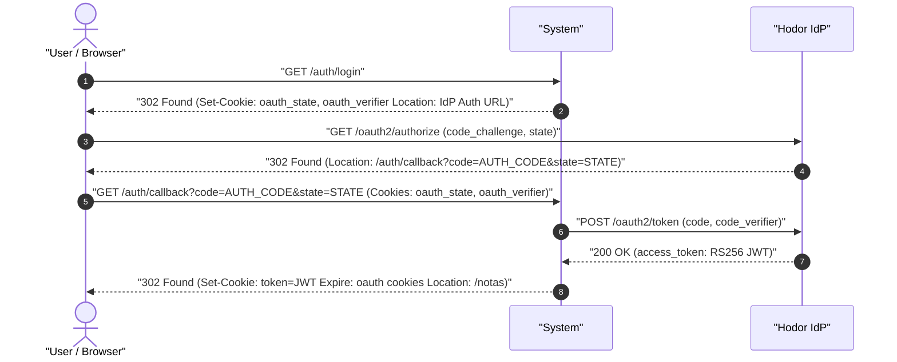
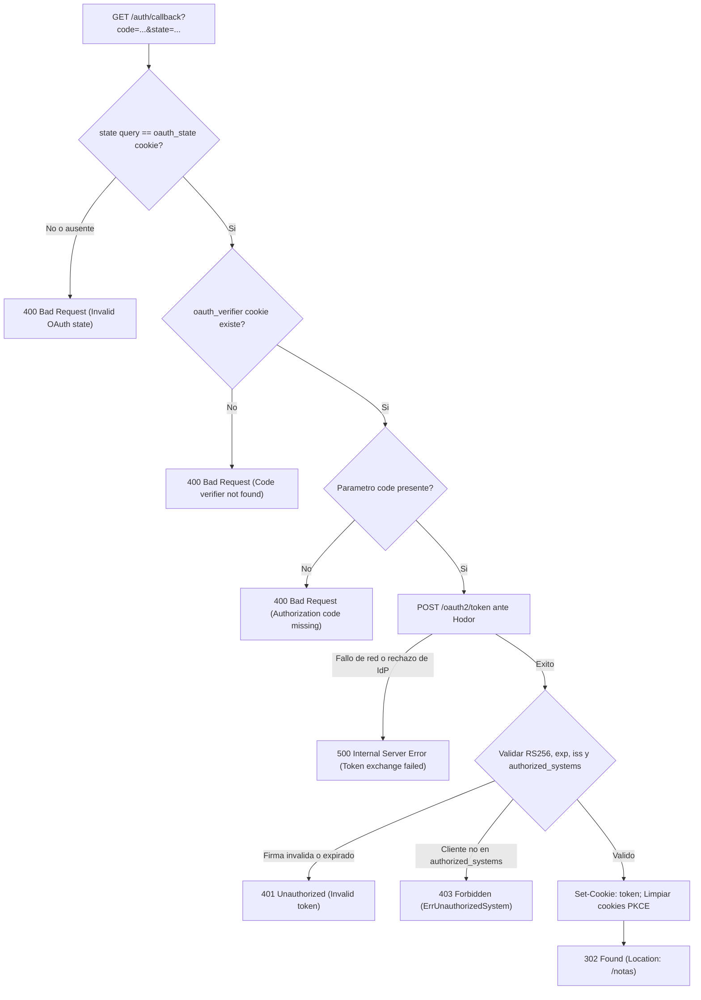

# UC-auth_federated_login: Inicio de Sesion Federado con Hodor (OIDC / PKCE)

> **Trazabilidad SDD:** Derivado de la spec `specs/003_autenticacion_hodor_spec.md` (Requisitos: `RF-01`, `RF-04`, `RF-05`, `RF-06`, `RF-09`, `RF-11`, `RF-12`).

## 1. Ficha de Intencion

- **ID:** UC-auth_federated_login
- **Actor Principal:** Usuario / Navegador web (o cliente HTMX)
- **Disparador:** Solicitud HTTP `GET /auth/login` (inicio del flujo) y retorno a `GET /auth/callback?code=...&state=...` (retorno del IdP)
- **Precondiciones:**
  - El servidor se encuentra inicializado con el validador JWKS de Hodor cargado en memoria (`fail-fast`, `RF-12`).
  - El Proveedor de Identidad Hodor (`IDP_HODOR_URL`) esta disponible y configurado con las credenciales de cliente OAuth2.
- **Invariantes de Negocio:**
  - Todo flujo de inicio de sesion utiliza Authorization Code Flow con PKCE (S256).
  - El sistema genera un desafio criptografico aleatorio (`state` de 32 bytes y `code_verifier`), persistidos en cookies temporales `HttpOnly` y `SameSite=Lax` con expiracion de 5 minutos.
  - Para peticiones HTMX (`HX-Request: true`), el inicio responde `200 OK` con cabecera `HX-Redirect` hacia el IdP para forzar navegacion total.
  - El endpoint de retorno `/auth/callback` valida que el parametro `state` coincida exactamente con la cookie temporal almacenada; de lo contrario, aborta con `400 Bad Request` sin contactar al IdP.
  - El intercambio del codigo y el verificador PKCE ante el IdP produce un `access_token` JWT firmado asimetricamente con algoritmo RS256.
  - El sistema valida la firma del token contra las claves publicas cacheadas en memoria del JWKS del IdP (`RF-06`, `RF-11`).
  - Al completar el intercambio y validacion, se establece la cookie de sesion `token` (`HttpOnly`, `SameSite=Lax`, `Path=/`), se eliminan las cookies temporales PKCE y se redirige con `302 Found` a `/notas` (`RF-09`).

## 2. Diagrama de Interaccion del Sistema (SSD)

## 3. Arbol de Decisiones

## 4. Caminos Alternativos y Catalogo de Errores

| Error Code                  | Causa Raiz                                                                                                 | Respuesta / Efecto                                                      |
| :-------------------------- | :--------------------------------------------------------------------------------------------------------- | :---------------------------------------------------------------------- |
| `400 Bad Request`           | Ausencia o discrepancia de `state`, falta de cookie `oauth_verifier` o parametro `code` faltante           | Cancelacion inmediata del flujo sin contactar al IdP (`RF-05`, `CL-03`) |
| `401 Unauthorized`          | El `access_token` entregado por el IdP no supera la validacion criptografica RS256 o se encuentra caducado | Rechazo de autenticacion sin establecer cookie de sesion (`RF-07`)      |
| `403 Forbidden`             | El token es valido pero no contiene el cliente configurado en el claim `authorized_systems`                | Acceso denegado al sistema (`RF-08`, `CL-04`)                           |
| `500 Internal Server Error` | Fallo de comunicacion durante el intercambio de token con Hodor                                            | Error interno del servidor                                              |

## 5. Postcondiciones y Efectos Secundarios

- **Estado Persistido:** Se establece la cookie `token` en el navegador del cliente; las cookies temporales `oauth_state` y `oauth_verifier` son eliminadas con expiracion en el pasado.
- **Eventos Emitidos:** Registro de log sobre autenticacion federada y resolucion de claims.
- **Auditoria:** Registro de sesion en la bitacora del servidor HTTP.
