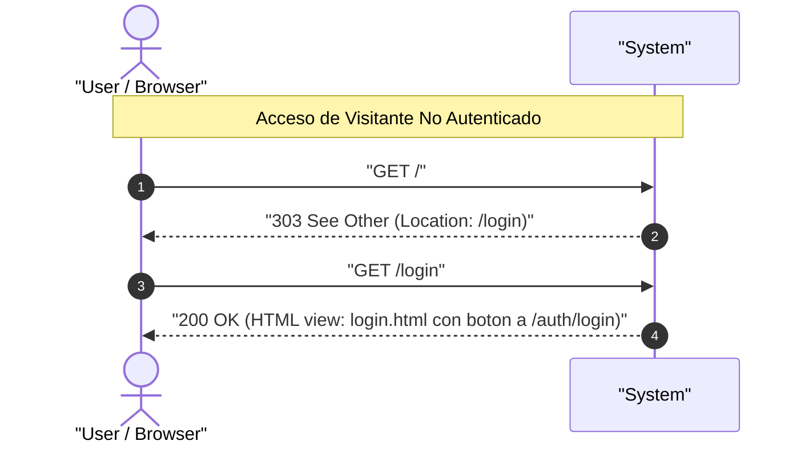
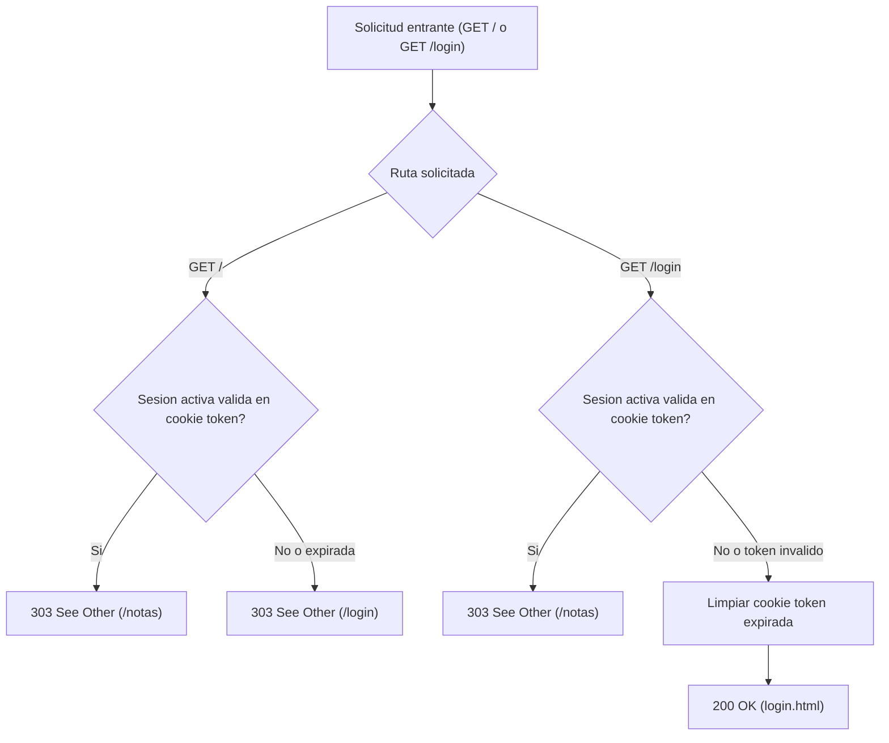

# UC-auth_landing: Visualizacion de Pantalla de Bienvenida y Enrutamiento Inicial

> **Trazabilidad SDD:** Derivado de la spec `specs/004_landing_login_logout_spec.md` (Requisitos: `RF-01`, `RF-02`, `RF-03`, `RF-04`, `CL-02`).

## 1. Ficha de Intencion

- **ID:** UC-auth_landing
- **Actor Principal:** Visitante no autenticado / Usuario autenticado
- **Disparador:** Solicitud HTTP `GET /` o `GET /login`
- **Precondiciones:**
  - El servidor web se encuentra operativo.
- **Invariantes de Negocio:**
  - Un visitante no autenticado que solicita `GET /` es redirigido mediante `303 See Other` hacia `/login` (`RF-04`).
  - La peticion `GET /login` para un visitante sin sesion renderiza la pantalla de bienvenida con codigo `200 OK`, sin redirigir automaticamente a ningun servicio externo (`RF-01`).
  - La pantalla de bienvenida incluye de forma visible un boton de accion explicita "Iniciar sesion con Hodor" que apunta a `/auth/login` (`RF-02`).
  - Un usuario con sesion valida y activa que accede a `/` o a `/login` es redirigido con `303 See Other` hacia el listado de notas `/notas` (`RF-03`).
  - Si un usuario accede a `/login` con una cookie `token` expirada o manipulada, el sistema invalida la cookie y renderiza la pantalla de bienvenida con `200 OK` (`CL-02`).

## 2. Diagrama de Interaccion del Sistema (SSD)

## 3. Arbol de Decisiones

## 4. Caminos Alternativos y Catalogo de Errores

| Error Code                  | Causa Raiz                                                                 | Respuesta / Efecto                                                                              |
| :-------------------------- | :------------------------------------------------------------------------- | :---------------------------------------------------------------------------------------------- |
| `303 See Other`             | Solicitud a `/` sin sesion, o solicitud a `/` o `/login` con sesion activa | Redireccion a `/login` (si es anonimo) o a `/notas` (si ya esta autenticado) (`RF-03`, `RF-04`) |
| `500 Internal Server Error` | Fallo inesperado en el renderizado del template `login.html`               | Mensaje de error interno del servidor                                                           |

## 5. Postcondiciones y Efectos Secundarios

- **Estado Persistido:** Si existia una cookie `token` invalida en `/login`, se emite cabecera `Set-Cookie` con `MaxAge: -1` para destruirla.
- **Eventos Emitidos:** Ninguno.
- **Auditoria:** Registro de acceso HTTP en la bitacora del servidor.
