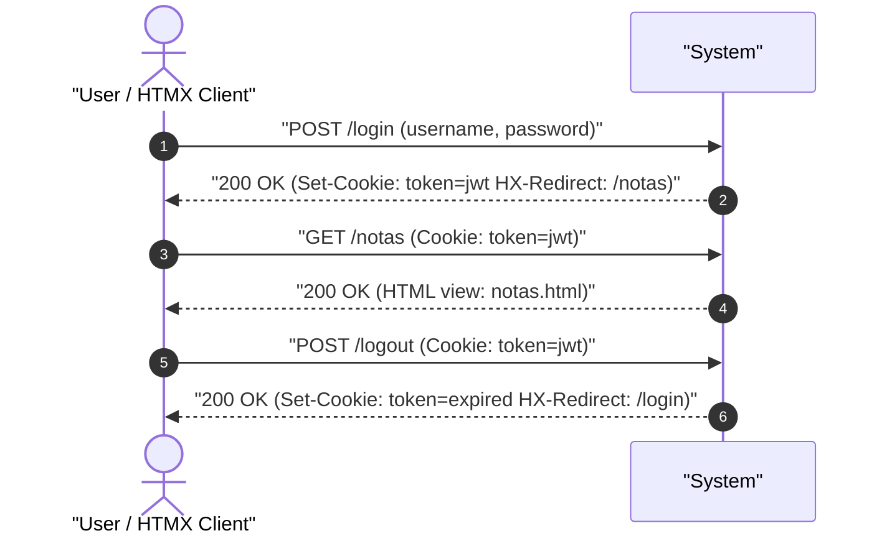

# UC-auth_session: Autenticacion Canonica y Control de Sesion

> **Trazabilidad SDD:** Derivado de la spec `specs/002_codigos_http_canonicos_spec.md` (Requisitos: `RF-01`, `RF-02`, `RF-06`, `RF-07`, `CL-03`, `CL-04`).

## 1. Ficha de Intencion

- **ID:** UC-auth_session
- **Actor Principal:** Usuario anonimo o autenticado / Cliente HTMX
- **Disparador:** Solicitudes HTTP a `GET /login`, `POST /login`, `POST /logout`, o peticion sin autorizar a cualquier ruta protegida
- **Precondiciones:**
  - El servidor web se encuentra en ejecucion y con base de datos accesible.
- **Invariantes de Negocio:**
  - El formulario de inicio de sesión público responde con código `200 OK`.
  - Credenciales vacías o incorrectas devuelven `401 Unauthorized` y no emiten cookie de sesión `token`.
  - El inicio de sesión correcto emite la cookie de sesión `token` y responde `200 OK` con cabecera `HX-Redirect: /notas` para navegación de página completa en HTMX.
  - El cierre de sesión destruye o invalida la cookie de sesión y responde `200 OK` con cabecera `HX-Redirect: /login`.
  - Toda ruta protegida que reciba una petición sin token, con token corrupto, con clave de firma errónea o caducado debe responder `303 See Other` hacia `/login` sin exponer datos de negocio.

## 2. Diagrama de Interaccion del Sistema (SSD)

## 3. Caminos Alternativos y Catalogo de Errores

| Error Code                  | Causa Raiz                                                                            | Respuesta / Efecto                                                  |
| :-------------------------- | :------------------------------------------------------------------------------------ | :------------------------------------------------------------------ |
| `303 See Other`             | Acceso a recurso protegido sin cookie `token`, o token con firma no valida o expirado | Redireccion con cabecera `Location: /login` (`RF-06`, `CL-03`)      |
| `401 Unauthorized`          | Credenciales de acceso vacias o usuario/contrasena incorrectos                        | Rechazo de login sin establecer cookie de sesion (`RF-07`, `CL-04`) |
| `500 Internal Server Error` | Error no esperado al verificar credenciales o procesar firma                          | Respuesta de error interno del servidor                             |

## 4. Postcondiciones y Efectos Secundarios

- **Estado Persistido:** Ninguna mutacion en la base de datos de usuarios (solo lectura de credenciales y verificacion hash).
- **Eventos Emitidos:** Emision de cabeceras de respuesta `Set-Cookie` y `HX-Redirect`.
- **Auditoria:** Registro de intentos de autenticacion y peticiones en el log del servidor.
