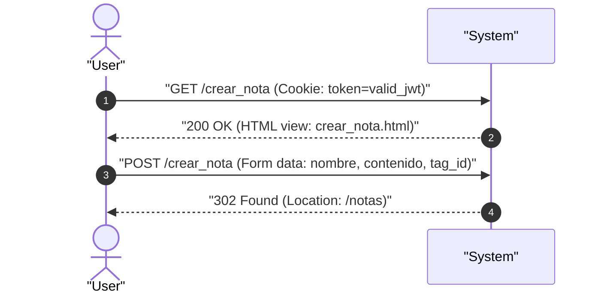

# UC-notes_create: Creacion de Nota y Renderizado de Formulario

> **Trazabilidad SDD:** Derivado de la spec `specs/002_codigos_http_canonicos_spec.md` (Requisitos: `RF-01`, `RF-03`, `RF-06`, `RF-08`).

## 1. Ficha de Intencion

- **ID:** UC-notes_create
- **Actor Principal:** Usuario autenticado / Cliente web
- **Disparador:** Solicitudes HTTP `GET /crear_nota` (renderizado) y `POST /crear_nota` (creacion)
- **Precondiciones:**
  - El usuario cuenta con una sesion activa y cookie de autenticacion valida.
- **Invariantes de Negocio:**
  - El formulario de creacion debe responder `200 OK` al solicitarse con credenciales validas.
  - La peticion de creacion debe procesar los parametros del formulario (`nombre`, `contenido`, `tag_id`).
  - El parametro `tag_id` debe ser un valor numerico valido interpretable en entero de 64 bits.
  - La creacion exitosa persiste la nota y su relacion con la etiqueta, respondiendo obligatoriamente con `302 Found` y cabecera `Location: /notas` (patron Post/Redirect/Get).
  - Peticiones con parametros no numericos o cuerpos ilegibles son rechazadas sin escribir en la persistencia.

## 2. Diagrama de Interaccion del Sistema (SSD)

## 3. Caminos Alternativos y Catalogo de Errores

| Error Code                  | Causa Raiz                                                        | Respuesta / Efecto                                                         |
| :-------------------------- | :---------------------------------------------------------------- | :------------------------------------------------------------------------- |
| `303 See Other`             | Peticion sin token de sesion, con token caducado o firma invalida | Redireccion a `/login` sin autorizar el acceso (`RF-06`)                   |
| `400 Bad Request`           | Fallo al parsear formulario o parametro `tag_id` no numerico      | Rechazo inmediato de la solicitud sin insercion en base de datos (`RF-08`) |
| `500 Internal Server Error` | Fallo de insercion o vinculacion en la persistencia SQLite        | Error interno del servidor                                                 |

## 4. Postcondiciones y Efectos Secundarios

- **Estado Persistido:** Se inserta una nueva fila en la tabla `notes` y su vinculacion en `note_tags`.
- **Eventos Emitidos:** Ninguno.
- **Auditoria:** Registro de acceso HTTP en la bitacora del servidor.
