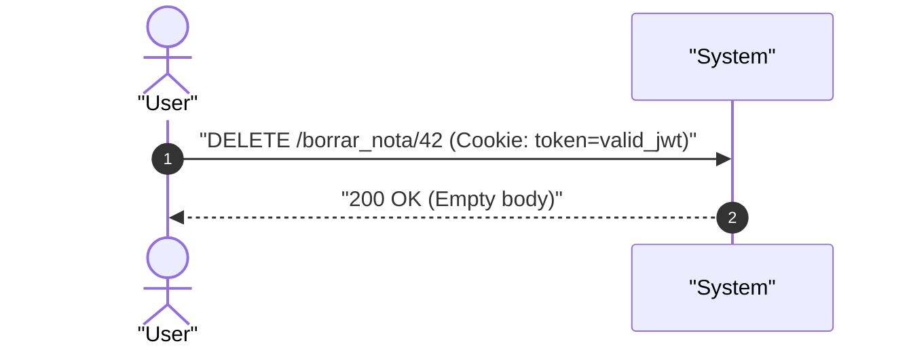
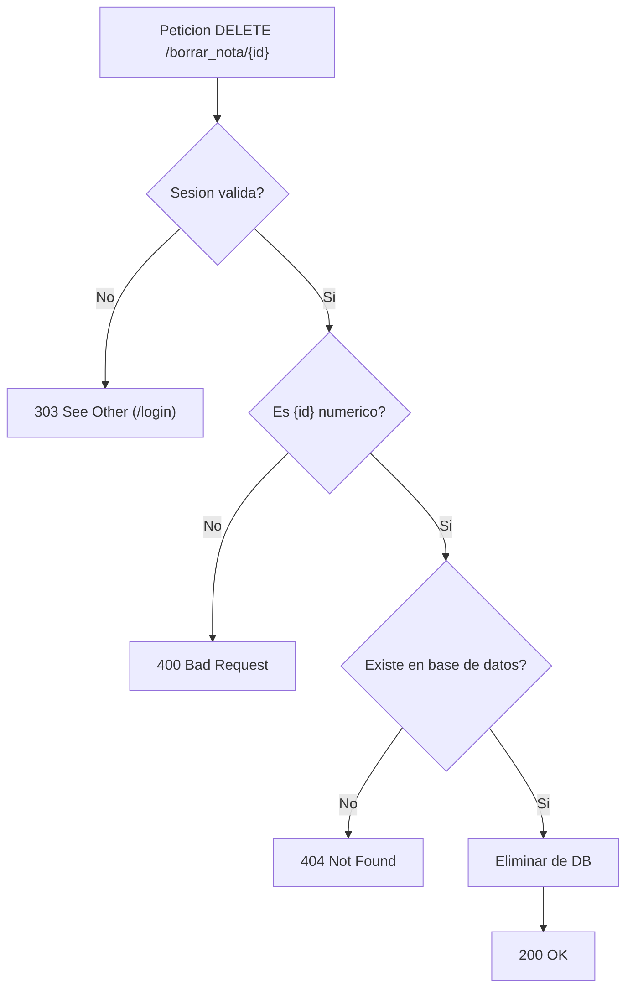

# UC-notes_delete: Eliminacion de Nota

> **Trazabilidad SDD:** Derivado de la spec `specs/002_codigos_http_canonicos_spec.md` (Requisitos: `RF-04`, `RF-05`, `RF-06`, `RF-08`, `CL-01`, `CL-02`).

## 1. Ficha de Intencion

- **ID:** UC-notes_delete
- **Actor Principal:** Usuario autenticado / Cliente HTMX
- **Disparador:** Solicitud HTTP `DELETE /borrar_nota/{id}`
- **Precondiciones:**
  - El usuario cuenta con una sesion activa y valida.
  - La nota referenciada por `{id}` debe existir en la base de datos para una eliminacion exitosa.
- **Invariantes de Negocio:**
  - El identificador `{id}` provisto en la URL debe ser un entero de 64 bits (`int64`). Si no es numerico, se rechaza inmediatamente con `400 Bad Request`.
  - El sistema comprueba la existencia de la nota antes de proceder con el borrado. Si no existe, devuelve `404 Not Found`.
  - Cuando la nota existe y es eliminada de la persistencia, el sistema responde `200 OK` (apto para que HTMX remueva el elemento del DOM mediante swap).
  - Si se solicita eliminar dos veces consecutivas la misma nota, la primera responde `200 OK` y la segunda responde `404 Not Found`.

## 2. Diagrama de Interaccion del Sistema (SSD)

## 3. Arbol de Decisiones

## 4. Caminos Alternativos y Catalogo de Errores

| Error Code                  | Causa Raiz                                                                  | Respuesta / Efecto                                                       |
| :-------------------------- | :-------------------------------------------------------------------------- | :----------------------------------------------------------------------- |
| `303 See Other`             | Peticion no autenticada, token invalido o expirado                          | Redireccion a `/login` sin autorizar la eliminacion (`RF-06`)            |
| `400 Bad Request`           | Parametro `{id}` en la URL no numerico                                      | Respuesta 400 sin ejecutar queries en DB (`RF-08`, `CL-02`)              |
| `404 Not Found`             | La nota indicada por `{id}` no existe en la persistencia o ya fue eliminada | Respuesta 404 informando recurso inexistente (`RF-05`, `CL-01`, `CL-02`) |
| `500 Internal Server Error` | Fallo de base de datos durante la consulta o la eliminacion                 | Respuesta 500 por error interno                                          |

## 5. Postcondiciones y Efectos Secundarios

- **Estado Persistido:** Se elimina la fila correspondiente en la tabla `notes` de SQLite.
- **Eventos Emitidos:** Ninguno.
- **Auditoria:** Registro de la peticion HTTP en la bitacora del servidor.
