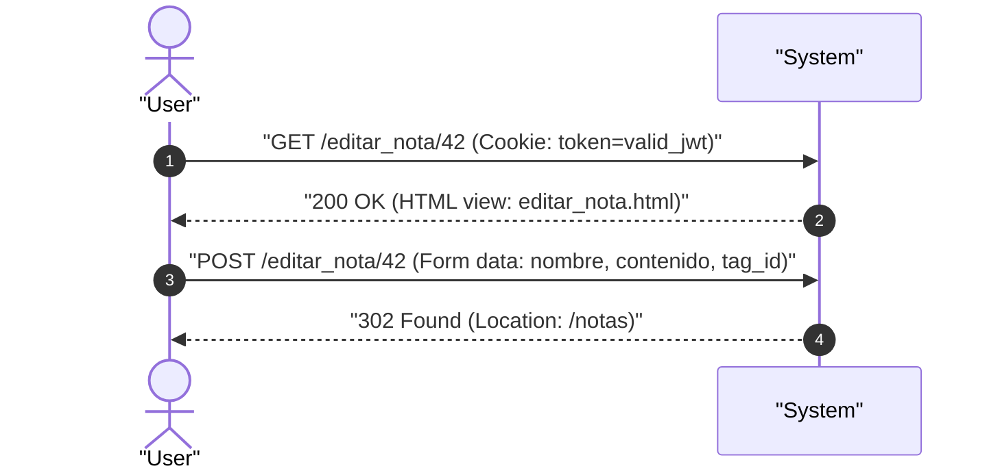
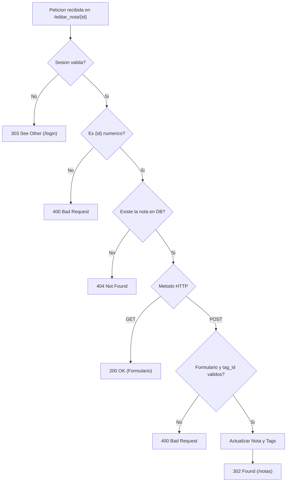

# UC-notes_edit: Modificacion y Formulario de Edicion de Nota

> **Trazabilidad SDD:** Derivado de la spec `specs/002_codigos_http_canonicos_spec.md` (Requisitos: `RF-01`, `RF-03`, `RF-05`, `RF-06`, `RF-08`, `CL-02`).

## 1. Ficha de Intencion

- **ID:** UC-notes_edit
- **Actor Principal:** Usuario autenticado / Cliente web
- **Disparador:** Solicitudes HTTP `GET /editar_nota/{id}` (renderizado) y `POST /editar_nota/{id}` (actualizacion)
- **Precondiciones:**
  - El usuario cuenta con una sesion autenticada valida.
  - La nota referenciada por `{id}` existe previamente en la base de datos para los flujos exitosos.
- **Invariantes de Negocio:**
  - El identificador `{id}` provisto en la URL debe ser numerico (`int64`). Si no lo es, se rechaza inmediatamente con `400 Bad Request` antes de cualquier consulta.
  - Si el identificador es numerico pero no coincide con ninguna nota persistida, el sistema debe responder `404 Not Found` sin emitir `500` ni confirmaciones falsas.
  - En solicitudes de renderizado validas, el sistema responde `200 OK` con el formulario prellenado.
  - En actualizaciones validas, el sistema modifica los campos persistidos y responde `302 Found` con redireccion a `/notas` (patron Post/Redirect/Get).

## 2. Diagrama de Interaccion del Sistema (SSD)

## 3. Arbol de Decisiones

## 4. Caminos Alternativos y Catalogo de Errores

| Error Code                  | Causa Raiz                                                                       | Respuesta / Efecto                                               |
| :-------------------------- | :------------------------------------------------------------------------------- | :--------------------------------------------------------------- |
| `303 See Other`             | Falta de token, firma invalida o token caducado                                  | Redireccion hacia `/login` (`RF-06`)                             |
| `400 Bad Request`           | Parametro `{id}` en URL no numerico, `tag_id` invalido o cuerpo malformado       | Respuesta 400 sin alterar datos (`RF-08`, `CL-02`)               |
| `404 Not Found`             | El identificador numerico no corresponde a una nota existente en la persistencia | Respuesta 404 informando ausencia del recurso (`RF-05`, `CL-02`) |
| `500 Internal Server Error` | Fallo de comunicacion o error no recuperable de SQLite                           | Respuesta 500 informando error del servidor                      |

## 5. Postcondiciones y Efectos Secundarios

- **Estado Persistido:** Para `POST`, se actualizan los valores `nombre` y `contenido` en la tabla `notes`, y se refrescan los registros asociados en `note_tags`.
- **Eventos Emitidos:** Ninguno.
- **Auditoria:** Registro de peticion HTTP en bitacora del servidor.
