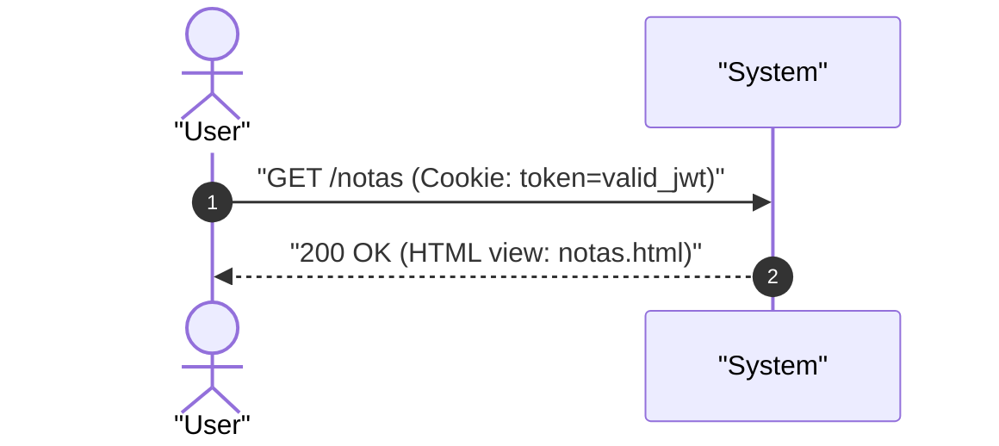

# UC-notes_list: Consulta y Visualizacion de Notas

> **Trazabilidad SDD:** Derivado de la spec `specs/002_codigos_http_canonicos_spec.md` (Requisitos: `RF-01`, `RF-06`).

## 1. Ficha de Intencion

- **ID:** UC-notes_list
- **Actor Principal:** Usuario autenticado / Cliente web
- **Disparador:** Solicitud HTTP `GET /notas`
- **Precondiciones:**
  - El usuario cuenta con una sesion valida con cookie `token`.
- **Invariantes de Negocio:**
  - Toda peticion a la ruta protegida `/notas` requiere verificacion de sesion activa.
  - La recuperacion exitosa del listado debe devolver obligatoriamente codigo HTTP `200 OK`.
  - Las notas recuperadas se presentan vinculadas a sus etiquetas correspondientes en la interfaz de usuario.

## 2. Diagrama de Interaccion del Sistema (SSD)

## 3. Caminos Alternativos y Catalogo de Errores

| Error Code                  | Causa Raiz                                                                      | Respuesta / Efecto                                                                   |
| :-------------------------- | :------------------------------------------------------------------------------ | :----------------------------------------------------------------------------------- |
| `303 See Other`             | Ausencia de cookie `token`, token malformado, secreto invalido o token expirado | Redireccion inmediata a `/login` sin entregar contenido protegido (`RF-06`, `CL-03`) |
| `500 Internal Server Error` | Fallo de lectura o conexion en la persistencia SQLite                           | Mensaje de error interno del servidor                                                |

## 4. Postcondiciones y Efectos Secundarios

- **Estado Persistido:** Ninguno (operacion de solo lectura).
- **Eventos Emitidos:** Ninguno.
- **Auditoria:** Registro estandar de la peticion HTTP en la bitacora del servidor.
